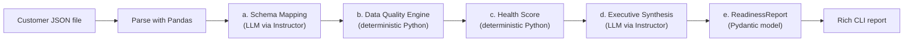

# Enterprise Schema Integrator & Data Readiness Agent

**An AI-assisted agent that maps a customer's messy legacy data onto your canonical schema, finds every data quality blocker, and tells leadership whether the data is ready to load — in seconds, not weeks.**

---

## 1. Overview & Business Value

### The problem

Every enterprise customer onboarding starts with a data export that doesn't match your schema. Columns are named `usr_full_name` or `total_revenue_usd`, dates arrive in three formats, emails are missing, and status values don't fit your model. Today this is handled by engineers and analysts manually mapping columns in spreadsheets and discovering data problems only when a load fails. That delays time-to-value and burns implementation hours.

### What this agent does

Point the agent at a customer data file and it produces a **Data Readiness Report**:

| Output | What it answers |
|---|---|
| **Schema mapping** | Which source column feeds which canonical field, and how confident is the mapping? |
| **Data quality issues** | Exactly which records will fail to load, and why, ranked CRITICAL / WARNING / INFO |
| **Data Health Score (0–100)** | One number that says how close the dataset is to being loadable |
| **Executive summary & next steps** | A two-sentence verdict and 1–2 strategic actions for leadership |

### Business value

- **Faster onboarding** — column mapping and data triage happen automatically instead of over days of back-and-forth.
- **No surprise load failures** — blockers are found before ingestion, with the record and field named.
- **A clear go / no-go signal** — the health score and verdict give implementation leads and executives a shared, objective readiness measure.
- **Root-cause actions, not busywork** — the action items target the customer's source process (e.g. enforcing required fields at extract time), so the next file arrives cleaner.
- **Trustworthy by design** — every rule and score is deterministic and auditable; AI is used only where judgment is needed (see below).

---

## 2. Architecture & Hybrid Design

The agent deliberately splits work between **deterministic Python** and an **LLM**. The LLM does what needs language understanding; everything that must be exact, repeatable, and auditable is plain code.



### Who does what

| Stage | Engine | Why |
|---|---|---|
| **a. Schema mapping** | LLM (Claude via Instructor) | Matching `contact_email_addr` → `email` is a semantic judgment that rules can't cover across every customer's naming conventions. |
| **b. Data quality rules** | Python | Whether an email contains `@` or a value is negative has one right answer. It must be exact, explainable, and identical on every run. |
| **c. Health score** | Python | A readiness score that changed between runs would be useless as a go / no-go signal. |
| **d. Executive synthesis** | LLM (Claude via Instructor) | Turning findings into a concise, business-readable verdict and strategic next steps is a writing task. |
| **e. Report assembly** | Pydantic | One typed `ReadinessReport` object, ready to render, store, or send to another system. |

### Guardrails on the LLM

- **Structured output only.** Instructor forces every LLM response into a Pydantic model (`SchemaMappingResult`, `ExecutiveSynthesis`). Free-form text never enters the pipeline.
- **Validation with automatic retry.** If the LLM maps to a field that doesn't exist, maps two columns to the same field, writes a summary over 280 characters, or mentions specific rows in an action item, validation fails and Instructor sends the error back to the model to correct (up to 2 retries).
- **Low-confidence mappings are flagged, not trusted.** Mappings below 70% confidence are excluded from validation and raised as a WARNING for human review. A required field with no trusted mapping is CRITICAL.
- **No invented facts.** The synthesis step receives only the computed score, mappings, and issues, and is instructed to use nothing else.
- **Data minimization.** Only column names and the first 5 records are sent to the LLM for mapping; the full dataset is validated locally.

### Data quality rules

All rules run on every record after mapping:

| Rule | Severity |
|---|---|
| Required field empty (any mapped canonical field) | CRITICAL |
| Email missing `@` | CRITICAL |
| Lifetime value negative or not a number | CRITICAL |
| Account status not `active` / `inactive` / `churned` (case-insensitive) | CRITICAL |
| Date unparseable | CRITICAL |
| Duplicate customer ID | CRITICAL |
| Required canonical field has no confident mapping | CRITICAL (whole dataset) |
| Date ambiguous between MM/DD and DD/MM (e.g. `12/05/2023`) | WARNING |
| Mapping confidence below 70% | WARNING |
| Number stored as formatted text (e.g. `"$64,980.00"`) | INFO |
| Leading / trailing whitespace in names | INFO |

**Severity meaning:** CRITICAL = blocks the record from loading · WARNING = data risk that needs review · INFO = non-breaking cleanup.

### Health score

```
score = 100 − 70 × (share of records with a CRITICAL issue)
            − 20 × (share of records with a WARNING)
            − 10 × (share of records with an INFO issue)
```

Because it's based on the *share* of records affected rather than a flat penalty per issue, the score stays meaningful for 10 records or 10 million. Any dataset-wide CRITICAL issue (e.g. no column maps to `email`) scores 0.

| Score | Verdict |
|---|---|
| 85–100 | READY TO LOAD |
| 60–84 | NEEDS REMEDIATION |
| 0–59 | NOT READY |

---

## 3. Tech Stack

| Component | Role | Version |
|---|---|---|
| **Python** | Runtime | 3.11+ (tested on 3.14) |
| **Anthropic Claude API** | Semantic mapping and executive synthesis (default model `claude-haiku-5-5`) | `anthropic` 1.13.0 |
| **Instructor** | Structured LLM output, validation, and automatic retries | 1.17.0 |
| **Pydantic** | Typed schemas for the canonical model, LLM responses, and the report | 2.14.1 |
| **Pandas** | Loading and processing source records | 3.0.6 |
| **Rich** | Terminal UI: tables, panels, spinners, theme | 13.9.4 |
| **python-dotenv** | Loading configuration from `.env` | 1.2.4 |
| **LangSmith** | Optional tracing of each pipeline step and LLM call | 0.14.8 |
| **OpenAI** | Optional fallback LLM provider | 3.3.0 |

All versions are pinned in `requirements.txt` to the exact set this project was tested with.

---

## 4. Quickstart & Setup

### Prerequisites

- Python 3.11 or newer (required by pandas 3)
- An [Anthropic API key](https://console.anthropic.com/) (optional — the app runs in offline mock mode without one)

### 1. Create a virtual environment and install dependencies

```bash
cd enterprise-schema-integrator
python3 -m venv venv
source venv/bin/activate          # Windows: venv\Scripts\activate
pip install -r requirements.txt
```

### 2. Configure your environment

```bash
cp .env.example .env
```

Open `.env` and set your Anthropic key:

```ini
ANTHROPIC_API_KEY=sk-ant-...
ANTHROPIC_MODEL=claude-haiku-5-5
```

`.env` is listed in `.gitignore`, so your key is never committed.

### 3. Run it

```bash
python main.py
```

Press **Enter** to analyze the bundled sample dataset.

### Configuration reference

| Variable | Purpose | Default |
|---|---|---|
| `ANTHROPIC_API_KEY` | Enables live mode with Claude | — |
| `ANTHROPIC_MODEL` | Claude model to use (e.g. `claude-sonnet-5-5` for more capability) | `claude-haiku-5-5` |
| `OPENAI_API_KEY` | Fallback provider if no Anthropic key is set | — |
| `OPENAI_MODEL` | OpenAI model to use | `gpt-4o-mini` |
| `LANGCHAIN_API_KEY` | Enables LangSmith tracing in live mode | — |
| `LANGCHAIN_PROJECT` | LangSmith project name | `enterprise-schema-integrator` |

**Provider selection:** Anthropic if `ANTHROPIC_API_KEY` is set → otherwise OpenAI if `OPENAI_API_KEY` is set → otherwise offline **mock mode**. Placeholder values copied from `.env.example` (starting with `your_`) count as unset. The active mode and model are shown in the report header.

---

## 5. Usage & Features

### Interactive mode

```bash
python main.py
```

The CLI asks for a file:

```
📁 Enter data file path (or press Enter for 'messy_customer_data.json'):
```

- **Press Enter** to use the bundled sample dataset.
- **Type a path**, relative or absolute (`~` is supported).
- **Drag and drop** a JSON file from Finder or File Explorer into the terminal window, then press Enter. Quoted paths and paths with escaped spaces (`/Users/me/My\ Data/export.json`) are handled automatically.

The file is checked **before** any processing or API calls: it must exist, be valid JSON, and contain a non-empty array of records. If it doesn't, the CLI explains why and asks again. Press **Ctrl+C** at any point to cancel.

### Command-line flags

```bash
python main.py --data-file path/to/customers.json   # skip the prompt
python main.py --mock                                # force offline mock mode
python main.py --help
```

| Flag | Description |
|---|---|
| `--data-file PATH` | Analyze this file without prompting (useful for scripts and CI) |
| `--mock` | Use the offline mock LLM even when an API key is set — a safe fallback for demos without network access |

**Exit codes:** `0` success · `1` invalid input or agent failure · `130` cancelled by the user.

### Input format

A JSON array of flat records. Column names can be anything; mapping them is the agent's job:

```json
[
  {
    "cust_ref_id": "CRM-10001",
    "usr_full_name": "Sarah Mitchell",
    "contact_email_addr": "sarah.mitchell@acmecorp.com",
    "reg_date_str": "2023-05-12",
    "total_revenue_usd": 48250.00,
    "client_status": "Active"
  }
]
```

### Canonical target schema

Defined in `schemas.py` as `CanonicalCustomer`:

| Field | Type |
|---|---|
| `customer_id` | string |
| `full_name` | string |
| `email` | string |
| `signup_date` | string (ISO `YYYY-MM-DD`) |
| `lifetime_value` | float |
| `account_status` | `active` \| `inactive` \| `churned` |

### Sample data

`messy_customer_data.json` contains 10 realistic records with deliberately seeded problems: non-standard column names, mixed date formats, a missing email (row 3), a negative lifetime value (row 5), a malformed email (row 7), and an unmapped `paused` status (row 8). Row numbers are 0-based. To regenerate it:

```bash
python generate_mock_data.py
```

### Observability

With a LangSmith key configured, each run is traced as a `readiness_pipeline` run with child runs for `schema_mapping`, `data_quality_engine`, `health_score`, and `executive_synthesis`, plus the raw Claude API calls. This shows the exact prompts, responses, retries, and latency for every stage.

---

## 6. Sample Report Preview

Live run against Claude (`claude-haiku-5-5`) on the bundled sample dataset. In the terminal, the report uses a blue theme, with red, yellow, and cyan reserved for severity.

```text
╭──────────────────────────────────────────────────────────────────────────────────────────────╮
│                                                                                              │
│                     ENTERPRISE SCHEMA INTEGRATOR & DATA READINESS AGENT                      │
│                                                                                              │
│                           LIVE MODE   anthropic · claude-haiku-5-5                           │
│                                    LangSmith tracing: off                                    │
│                                                                                              │
╰──────────────────────────────────────────────────────────────────────────────────────────────╯
📁 Enter data file path (or press Enter for 'messy_customer_data.json'):
✓ Loaded messy_customer_data.json (10 records)

[17:00:00] ✓ Parsing source data
[17:00:04] ✓ Mapping source schema to canonical model
           ✓ Running data quality checks
[17:00:08] ✓ Writing executive summary


 1 Schema Mapping  ─────────────────────────────────────────────────────────────────────────────

╭────────────────────┬────────────────┬────────────╮
│ Source Field       │ Target Field   │ Confidence │
├────────────────────┼────────────────┼────────────┤
│ cust_ref_id        │ customer_id    │        97% │
│ usr_full_name      │ full_name      │        95% │
│ contact_email_addr │ email          │        96% │
│ reg_date_str       │ signup_date    │        85% │
│ total_revenue_usd  │ lifetime_value │        90% │
│ client_status      │ account_status │        92% │
╰────────────────────┴────────────────┴────────────╯

 2 Data Quality  ───────────────────────────────────────────────────────────────────────────────

╭──────────┬─────┬────────────────┬────────────────────┬───────────────────────────────────────╮
│ Severity │ Row │ Field          │ Issue              │ Description                           │
├──────────┼─────┼────────────────┼────────────────────┼───────────────────────────────────────┤
│ CRITICAL │   3 │ email          │ missing_value      │ Required field 'email' is empty.      │
│ CRITICAL │   5 │ lifetime_value │ invalid_value      │ Lifetime value is negative            │
│          │     │                │                    │ (-1,500.00).                          │
│ CRITICAL │   7 │ email          │ invalid_format     │ Email 'omar.haddad.cyberdyne.com' is  │
│          │     │                │                    │ missing '@'.                          │
│ CRITICAL │   8 │ account_status │ unmapped_value     │ Status 'paused' is not one of         │
│          │     │                │                    │ ['active', 'churned', 'inactive'];    │
│          │     │                │                    │ needs a business rule before load.    │
│ WARNING  │   1 │ signup_date    │ ambiguous_date     │ Date '12/05/2023' could be MM/DD or   │
│          │     │                │                    │ DD/MM; confirm source locale.         │
│ INFO     │   1 │ lifetime_value │ non_numeric_format │ Value '12,400.50' is stored as text;  │
│          │     │                │                    │ normalize to 12400.5.                 │
│ INFO     │   4 │ full_name      │ whitespace         │ Name '  Maria Gonzalez ' has          │
│          │     │                │                    │ leading/trailing whitespace.          │
│ INFO     │   9 │ lifetime_value │ non_numeric_format │ Value '$64,980.00' is stored as text; │
│          │     │                │                    │ normalize to 64980.0.                 │
╰──────────┴─────┴────────────────┴────────────────────┴───────────────────────────────────────╯
╭─ Severity legend ────────────────────────────────────────────────────────────────────────────╮
│ ● CRITICAL  Blockers that prevent record loading (missing required fields, invalid formats). │
│ ● WARNING   Data quality risks that need review (ambiguous date formats).                    │
│ ● INFO      Non-breaking formatting issues or minor cleanups.                                │
╰──────────────────────────────────────────────────────────────────────────────────────────────╯

 3 Readiness Assessment  ───────────────────────────────────────────────────────────────────────

╭───────────────────────────────────── Data Health Score ──────────────────────────────────────╮
│                                                                                              │
│                                            67/100                                            │
│                                      NEEDS REMEDIATION                                       │
│                                                                                              │
│                   10 records   ·   4 critical   ·   1 warning   ·   3 info                   │
│                                                                                              │
╰──────────────────────────────────────────────────────────────────────────────────────────────╯
╭─ Executive Summary ──────────────────────────────────────────────────────────────────────────╮
│                                                                                              │
│  Not ready to load: the data health score is 67, with 4 critical issues across 10 records.   │
│  The blockers are a missing required email, an invalid email format, a negative lifetime     │
│  value, and an unmapped 'paused' account status.                                             │
│                                                                                              │
╰──────────────────────────────────────────────────────────────────────────────────────────────╯
╭─ Key Action Items ───────────────────────────────────────────────────────────────────────────╮
│                                                                                              │
│  ▸ Require the source system to enforce mandatory email and status enum values.              │
│                                                                                              │
│  ▸ Standardize date formats and currency fields in the source extract contract.              │
│                                                                                              │
╰──────────────────────────────────────────────────────────────────────────────────────────────╯
```

The data quality findings and the 67/100 score are deterministic and identical on every run. The mapping confidences and the wording of the summary and action items come from the LLM and vary slightly between runs.

---

## Project Structure

```
enterprise-schema-integrator/
├── main.py                    # Rich CLI: file prompt, provider selection, report rendering
├── agent.py                   # Pipeline: LLM mapping, quality rules, health score, synthesis
├── schemas.py                 # Pydantic models: CanonicalCustomer, FieldMapping, DataIssue, ReadinessReport
├── mock_llm.py                # Offline stand-in for the LLM (same interface, no API calls)
├── generate_mock_data.py      # Generates the messy sample dataset
├── messy_customer_data.json   # Sample dataset (10 records with seeded issues)
├── requirements.txt           # Pinned dependencies
├── .env.example               # Configuration template
└── .gitignore                 # Excludes .env, venv/, caches
```

---

## Path to Production

This project is a working prototype. Taking it to production would involve:

- **Service deployment** — expose `run_pipeline()` behind an API or a queue worker so onboarding tools can submit files and receive a `ReadinessReport` as JSON.
- **Configurable schemas** — load canonical schemas and quality rules per customer or product line instead of the single built-in `CanonicalCustomer`.
- **Human-in-the-loop review** — let implementation engineers approve or correct low-confidence mappings and save them for that customer's future files.
- **Evaluation** — a labeled set of real source schemas to measure mapping accuracy whenever the prompt or model changes.
- **Scale** — stream large files in chunks for validation; the LLM only ever sees the header and a sample, so its cost stays flat as data volume grows.
- **Governance** — PII handling policy for the sampled records, secrets in a vault rather than `.env`, and audit logs of every readiness decision.
